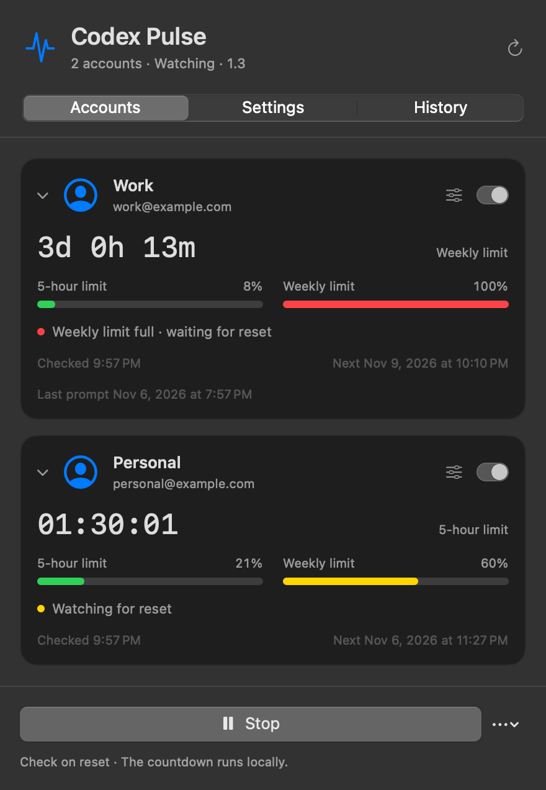
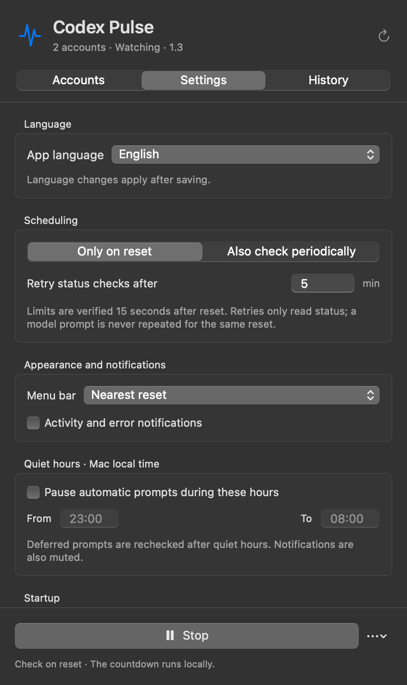
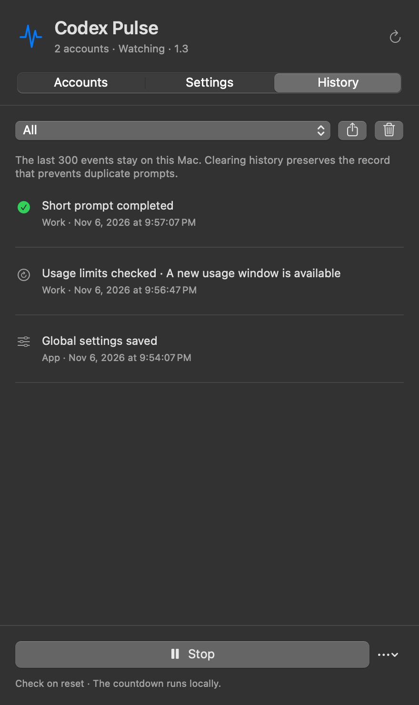

# Codex Pulse

A macOS menu bar companion for **Monocode's Codex accounts**. See usage windows,
follow their reset times, and optionally send one short prompt after Codex confirms
that usage is available again.

[Download the latest release](https://github.com/erhanyigiter/Codex-Pulse/releases/latest)
 · [User guide](USAGE.md)
 · [Türkçe kullanım rehberi](KULLANIM.md)
 · [Contributing](CONTRIBUTING.md)



<sub>Weekly limit full: countdown to the weekly reset. All screenshots use sample accounts.</sub>

## What's new in 1.3.0

- Discover the default signed-in account in `~/.codex` alongside Monocode profiles.
- Show the weekly reset countdown when the weekly limit is full, including collapsed rows and the menu bar.
- Usage colors: green below 50%, yellow from 50% to 99%, red at 100%.
- Keep English/Turkish support, independent dropdowns, and existing preferences.

## Features

- A compact live countdown in every collapsed account row, without increasing the panel size.
- Independent dropdowns: expand several accounts at once; all start collapsed.
- A responsive one-to-three-account panel, with scrolling for additional accounts.
- Clear **5-hour limit** and **Weekly limit** usage bars.
- **English by default**, with Turkish available in Settings → Language.
- Press Enter to save a nickname and close its dialog after confirmation.
- **Reset-only mode:** wait for the server-reported reset instead of polling on a fixed schedule.
- Optional periodic status checks with your own interval in minutes.
- A separate, configurable retry interval for status errors or delayed resets.
- Global start/stop and individual account switches. Disabled profiles are skipped on startup, manual refresh, retries, wake, and CLI status checks.
- Account nicknames, per-account scheduling overrides, and a selectable menu bar countdown.
- Quiet hours, optional macOS notifications, and configurable startup behavior.
- A local history of the last 300 events, with filtering and JSON export.
- A durable attempt journal: restarting the app or clearing history does not send
  another prompt for the same observed reset.
- Duplicate profiles for the same verified account share the attempt journal.

**This app does not reset limits, increase quotas, or redeem reset credits.**
An automated prompt consumes account usage. It cannot guarantee that a request
starts a new usage window. Automation is off by default.

## Install

1. Download `Codex-Pulse-1.3.0-universal.dmg` from [Releases](https://github.com/erhanyigiter/Codex-Pulse/releases).
2. Copy **Codex Pulse.app** to Applications, or to your personal `~/Applications` folder.
3. Open the copied app and click the waveform icon in the menu bar.
4. Review **Settings**, save your choices, then click **Start / Başlat**.

English is the default. To switch languages, open **Settings → Language**, choose **English** or **Türkçe**, then **Save settings**. Menus, status messages, notifications, history and dates update without restarting. Your nicknames are preserved. Quit an older copy before replacing it.

### Requirements

- macOS **13 or newer**.
- Apple Silicon or Intel Mac. The app is built as Universal 2; runtime testing for
  this release was performed on Apple Silicon.
- Python 3 available at **`/usr/bin/python3`**. This is not bundled. On a fresh
  Mac, installing Apple's Command Line Tools may be necessary.
- A compatible **Codex CLI**, discoverable through PATH, `~/.local/bin/codex`,
  `/opt/homebrew/bin/codex`, or `/usr/local/bin/codex`.
- **Monocode**, with your own ChatGPT-backed Codex accounts already signed in.

Releases are **ad-hoc signed, not Developer ID signed or notarized**. macOS may
block an app downloaded from the internet. Creating a DMG does not remove that
restriction. This project is not an official OpenAI or Monocode product.

## How scheduling works

The app reads `account/read` and `account/rateLimits/read` through Codex's local
app-server protocol. Each Monocode profile gets its own `CODEX_HOME`.

In reset-only mode, after the initial status read, the app waits for the reported
five-hour window's `resetsAt`, plus a 15-second grace period. It reads status again
before considering a prompt. A full weekly window waits for its known reset.
Errors or unconfirmed resets use your configured status retry interval.

A prompt is eligible only when account identity, the five-hour window, and the
backend's `ordinaryUsageAllowed` permission can be verified. Unsupported or
incomplete responses fail closed. API-key-only profiles do not receive prompts.

The app records an attempt **before** starting the CLI. A failed, cancelled, or
interrupted attempt is not automatically repeated for that reset. Clearing the
visible history preserves this journal.

Prompts run from an empty temporary directory with a read-only sandbox. The
instruction asks Codex to use no tools, read no files, and answer only `OK`.
Status-only refreshes do not create model turns. Sleeping or powered-off Macs
cannot perform checks; on wake, an active watcher reads the current state without
sending a backlog of prompts.

The Codex app-server interface is experimental and may change. This version
requires the identity and permission fields used by its backend; older CLI
versions may display status but refuse automation.

The **5-hour limit** and **Weekly limit** labels are provided by Codex Pulse; Monocode does not supply those UI strings. Usage percentages and reset timestamps come from Codex.

## Local data

Accounts are discovered under:

```text
~/Library/Application Support/com.monocode.desktop/provider-accounts/codex/account-*
~/.codex (default account, when auth.json exists)
```

The app's preferences, aliases, history, and attempt journal stay in:

```text
~/Library/Application Support/Codex Pulse/state.json
```

Codex Pulse does not read, copy, or export authentication token contents. The
Codex CLI uses each existing profile's auth in place and may refresh it itself.
The app does not switch Monocode's selected account. It strips API-key environment
variables from child processes.

Source archives and release packages do not include accounts, auth files,
preferences, or personal history. Exported history is local metadata; review it
before sharing. If Monocode changes its storage layout, account discovery may
need an update.

## Build and test

No third-party Python packages or Swift package dependencies are required.
Building needs Xcode Command Line Tools and the macOS SDK.

```sh
git clone https://github.com/erhanyigiter/Codex-Pulse.git
cd Codex-Pulse
python3 -m unittest discover -s tests -v
bash build.sh
open "dist/Codex Pulse.app"
```

The tests use synthetic accounts and a fake CLI. They do not use your login or
send requests to OpenAI. The build produces an ad-hoc signed Universal 2 app.

To inspect real account limits **without sending model prompts**:

```sh
python3 backend.py --check
```

To create a DMG and an independent source archive:

```sh
bash package.sh --no-build
```

Build outputs go into ignored `dist/`. The app bundle contains its own backend
and does not depend on the source directory after installation.

<details>
<summary>Expanded accounts, language settings, and activity history</summary>





</details>

All previews show the English interface and use sample accounts. No real account information or user screenshots are included.

## License

[MIT](LICENSE) · Copyright 2026 erhanyigiter.

Protocol reference: [Codex App Server](https://developers.openai.com/codex/app-server/).
